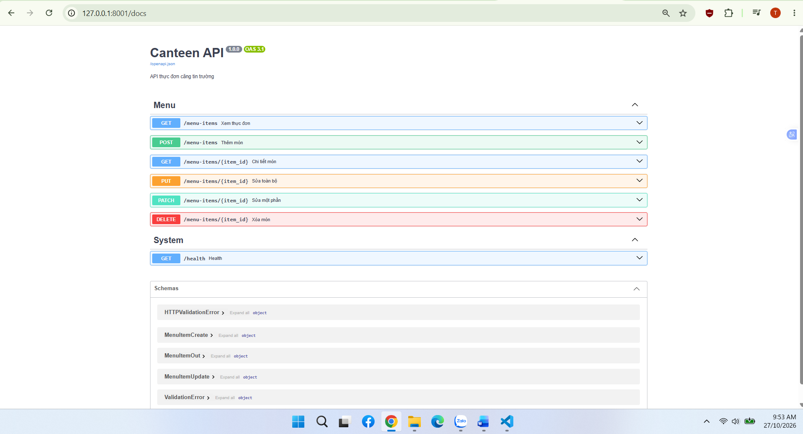
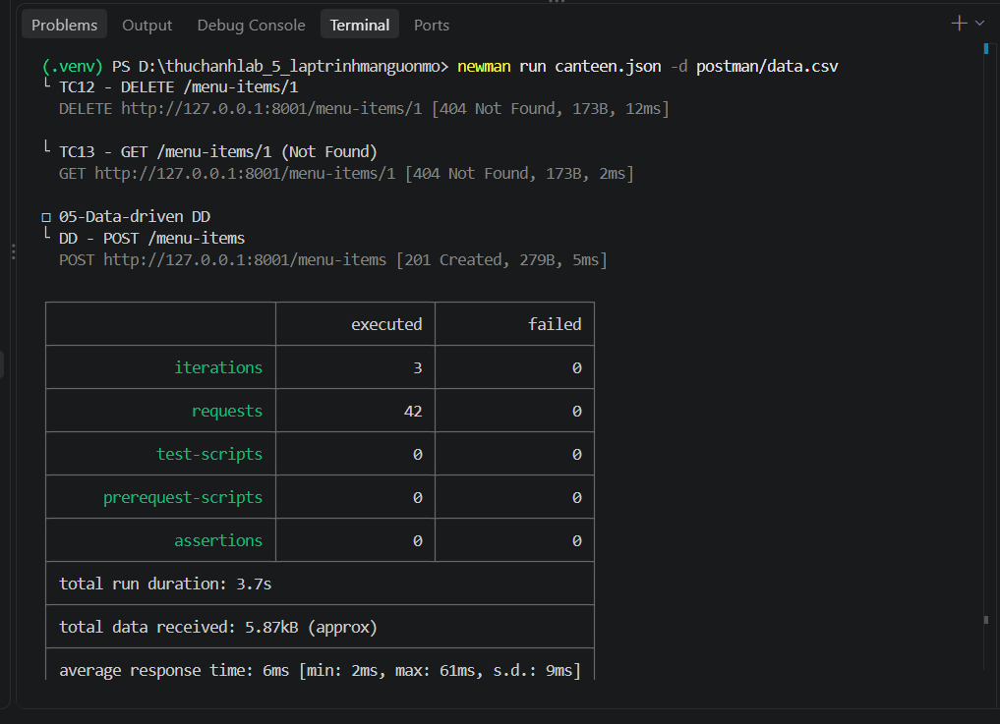
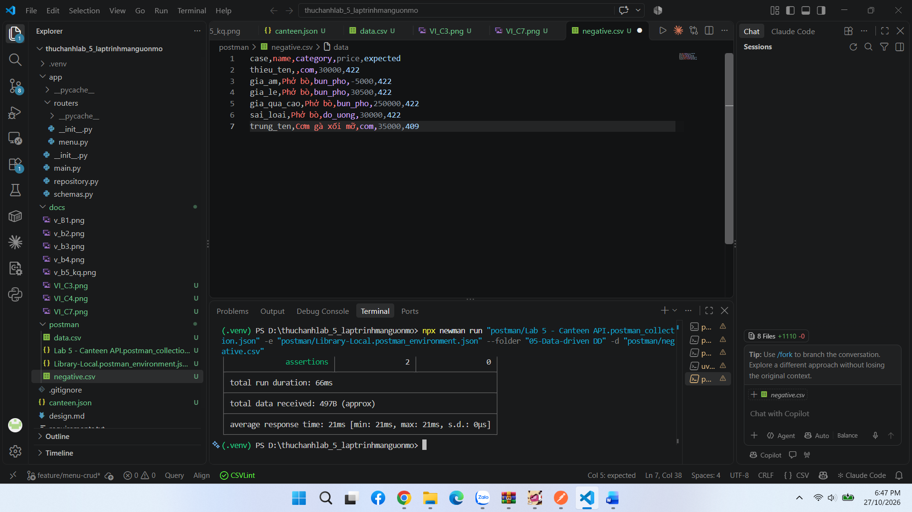

# Lab 5 - Canteen API & Automated Testing

Dự án xây dựng ứng dụng Canteen API sử dụng **FastAPI**, kết hợp kiểm thử tự động với **Postman**, **Newman** và quản lý mã nguồn bằng **Git**.

---

## 📂 Cấu trúc thư mục dự án
- `app/`: Mã nguồn FastAPI (routers, schemas, repository).
- `postman/`: Collection, Environment và file dữ liệu kiểm thử (`negative.csv`).
- `docs/`: Chứa ảnh kết quả kiểm thử và tệp thiết kế (`design.md`).
- `requirements.txt`: Danh sách các thư viện Python cần thiết.
- `README.md`: Tài liệu hướng dẫn cài đặt và minh chứng kiểm thử.

---

## 🚀 Hướng dẫn cài đặt và chạy ứng dụng

### 1. Cài đặt thư viện phụ thuộc
```bash
pip install -r requirements.txt


## Minh chứng kết quả (Screenshots)

### 1. Ảnh Swagger


### 2. Ảnh Postman Runner


### 3. Ảnh Newman
